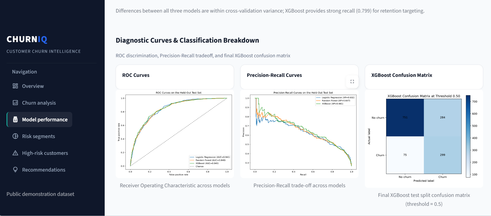

# Customer Churn Prediction

An end-to-end machine learning project that validates and cleans the IBM Telco Customer Churn dataset, explores churn patterns, trains three class-weighted models, evaluates a final model, segments customers by risk, stores results in SQLite, and presents them in a Streamlit dashboard.

The dataset, trained models, database and customer-level predictions are not stored in this repository. They are regenerated by the pipeline.

## Dashboard

A SQLite-backed Streamlit dashboard with six sections: Overview, Churn analysis, Model performance, Risk segments, High-risk customers and Recommendations.





## Headline Results

*The figures below come from files generated by the pipeline (in `outputs/`), which are not committed. Running `python scripts/run_pipeline.py` reproduces them.*

**Dataset and churn:** The cleaned dataset contains 7,043 customers, and 26.54% are marked as churned.

**Key finding:** Month-to-month customers churn at 42.7%, compared with 2.8% for customers on two-year contracts.

### Model comparison

| Model | CV ROC-AUC | CV std | Test ROC-AUC | Test recall | Test precision |
|---|---:|---:|---:|---:|---:|
| Logistic Regression | 0.846 | 0.012 | 0.841 | 0.789 | 0.497 |
| Random Forest | 0.846 | 0.009 | 0.840 | 0.759 | 0.529 |
| XGBoost | 0.847 | 0.012 | 0.845 | 0.799 | 0.513 |

The held-out differences are small, and the cross-validation differences are within fold standard deviations, so the models are not clearly separated by this evidence. XGBoost is the final practical choice for retention-oriented review, but it is not claimed to be universally superior.

### Risk tiers

| Tier | Customers | Actual churn rate | Average tenure (months) |
|---|---:|---:|---:|
| Low | 4,161 | 8.89% | 43.25 |
| Medium | 646 | 31.89% | 26.62 |
| High | 2,236 | 57.83% | 13.79 |

Observed churn rises steadily from the Low tier to the High tier.

### Top churn drivers (permutation importance)

- Contract: 0.0736
- Tenure: 0.0560
- InternetService: 0.0097
- TechSupport: 0.0056
- OnlineSecurity: 0.0055

Contract type and tenure are the strongest associated factors. These are associations, not proof of cause.

## Quick Start (Windows PowerShell)

Clone the repository:

```powershell
git clone https://github.com/varshney-kanishka/customer-churn-prediction.git
cd customer-churn-prediction
```

Create and activate a virtual environment, then install the dependencies:

```powershell
py -3.12 -m venv .venv
.venv\Scripts\Activate.ps1
python -m pip install --upgrade pip
pip install -r requirements.txt
```

If PowerShell blocks activation, run this for the current window only, then activate again:

```powershell
Set-ExecutionPolicy -Scope Process -ExecutionPolicy Bypass
```

Download the IBM Telco Customer Churn CSV from [Kaggle](https://www.kaggle.com/datasets/blastchar/telco-customer-churn) and place it at:

```text
data/raw/WA_Fn-UseC_-Telco-Customer-Churn.csv
```

Run the complete pipeline (validation, cleaning, training, evaluation, segmentation, database):

```powershell
python scripts/run_pipeline.py
```

Reuse existing models and skip retraining:

```powershell
python scripts/run_pipeline.py --skip-training
```

Run the tests:

```powershell
pytest
```

Launch the dashboard from the project root:

```powershell
streamlit run dashboard/app.py
```

Then open http://localhost:8501 in your browser.

## Project Structure

```text
data/raw/                 Source dataset (ignored by Git)
data/processed/           Cleaned CSV, split indices and SQLite database (ignored by Git)
src/                      Loading, validation, cleaning, features, database, evaluation
scripts/                  Validation, cleaning, training, evaluation, segmentation, pipeline
notebooks/                Customer churn EDA notebook
models/                   Saved scikit-learn pipelines (ignored by Git)
outputs/figures/          Static and interactive figures
outputs/metrics/          Model and evaluation metrics
outputs/predictions/      Customer-level risk scores (ignored by Git)
outputs/reports/          Validation, cleaning, training, evaluation and segmentation reports
reports/                  Business recommendations and final project report
dashboard/                SQLite-backed Streamlit app
docs/images/              Dashboard screenshots
tests/                    Unit and integration tests
```

## Technology Stack

Python 3.12, pandas, NumPy, scikit-learn, XGBoost, Matplotlib, Seaborn, Plotly, Streamlit, SQLite, Jupyter, pytest and Git.

## Limitations

- This is a single public historical snapshot, so there is no time dimension.
- The churn drivers are associations, not proof of cause.
- Risk scores from the class-weighted models rank customers but are not calibrated probabilities.
- The dataset provides no verified cost or revenue data for retention-offer decisions.
- The public demonstration dataset should not be treated as live customer data.

## Generated Data Policy

The raw and cleaned CSV files, the SQLite database, the saved `.joblib` models and the customer risk-score CSV are not in the repository. They are regenerated by running the pipeline.

## Tested Environment

Tested on Windows with Python 3.12.4.