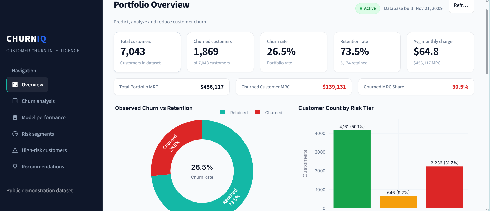
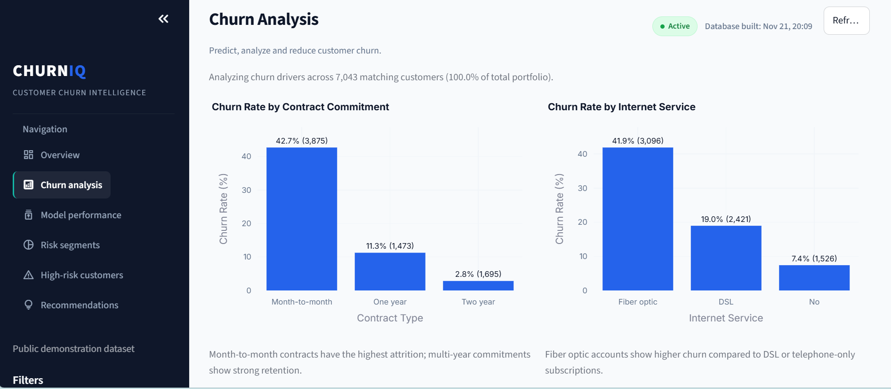
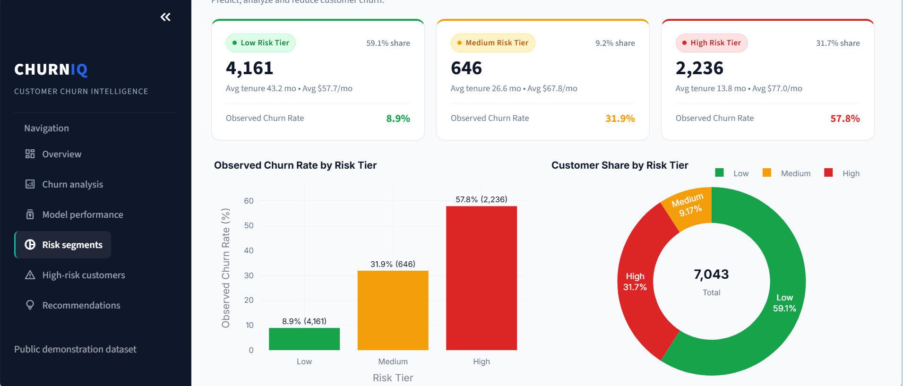
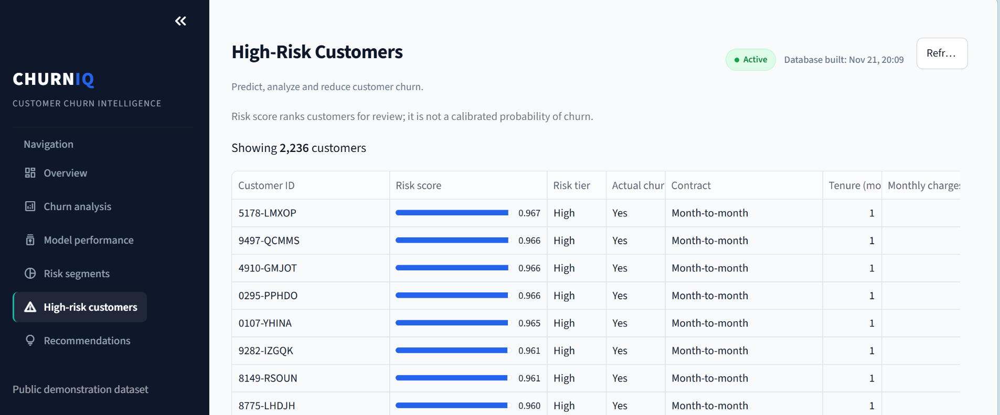

# Customer Churn Prediction

This project validates and cleans IBM Telco Customer Churn data, explores churn patterns, trains three class-weighted models, evaluates a retained final model, segments customers by risk, stores results in SQLite, and presents a Streamlit dashboard. The work is reproducible and excludes the public dataset, models, database, and customer-level predictions from the repository.

## Headline Results

**Dataset and churn:** The cleaned dataset contains 7,043 customers; 26.54% are marked as churned. Source: `outputs/metrics/model_metrics.json`, split counts; and `outputs/reports/risk_segmentation_report.md`.

### Model comparison

| Model | CV ROC-AUC | CV std | Test ROC-AUC | Test recall | Test precision |
|---|---:|---:|---:|---:|---:|
| Logistic Regression | 0.846 | 0.012 | 0.841 | 0.789 | 0.497 |
| Random Forest | 0.846 | 0.009 | 0.840 | 0.759 | 0.529 |
| XGBoost | 0.847 | 0.012 | 0.845 | 0.799 | 0.513 |

Source: `outputs/metrics/model_metrics.json` and `outputs/metrics/evaluation_metrics.json`. The held-out differences are small and Phase 4 cross-validation differences are within fold standard deviations, so the models are not treated as clearly separated by this evidence. XGBoost is the final practical choice for retention-oriented review, but it is not claimed as universally superior.

**Risk tiers:**

| Tier | Customers | Actual churn rate | Average tenure (months) |
|---|---:|---:|---:|
| Low | 4,161 | 8.89% | 43.25 |
| Medium | 646 | 31.89% | 26.62 |
| High | 2,236 | 57.83% | 13.79 |

Source: `outputs/reports/risk_segmentation_report.md`. The threshold and tiers are real project outputs, with Low-to-High observed churn rising 8.89%, 31.89%, and 57.83%.

**Top churn drivers:**

- Contract permutation importance: 0.0736
- Tenure permutation importance: 0.0560
- InternetService permutation importance: 0.0097
- TechSupport permutation importance: 0.0056
- OnlineSecurity permutation importance: 0.0055

Source: `outputs/reports/model_evaluation_report.md`. These are associations, not proof of cause.

## Dashboard

**Screenshots to be added.**

### Overview



### Churn analysis



### Model performance


### Risk segments



### High-risk customers



The placeholders point to future manually added screenshots. No fabricated images are included.

## Quick Start on Windows PowerShell

Clone the repository:

```powershell
git clone <repository-url>
cd Customer-Churn-Prediction
```

Create and activate a virtual environment:

```powershell
py -3.12 -m venv .venv
.venv\Scripts\Activate.ps1
python -m pip install --upgrade pip
pip install -r requirements.txt
```

Download the IBM Telco Customer Churn CSV from Kaggle and place it at:

```text
data/raw/WA_Fn-UseC_-Telco-Customer-Churn.csv
```

Run the complete pipeline:

```powershell
python scripts/run_pipeline.py
```

Reuse existing models and skip retraining:

```powershell
python scripts/run_pipeline.py --skip-training
```

Run tests:

```powershell
pytest
```

Launch the dashboard:

```powershell
streamlit run dashboard/app.py
```

## Project Structure

```text
data/raw/                 Source dataset; ignored by Git
data/processed/           Cleaned CSV, split indices, and SQLite database
src/                      Loading, validation, cleaning, features, database, evaluation
scripts/                  Validation, cleaning, training, evaluation, segmentation, pipeline
notebooks/                Customer churn EDA notebook
models/                   Saved sklearn pipelines; ignored by Git
outputs/figures/          Static and interactive dashboard-ready figures
outputs/metrics/          Phase 4 and Phase 5 metrics
outputs/predictions/      Customer-level risk scores; ignored by Git
outputs/reports/          Validation through segmentation reports
reports/                  Business recommendations and final project report
dashboard/                SQLite-backed Streamlit app
docs/images/              Manual dashboard screenshot placeholders
tests/                    Unit and integration tests
```

## Technology Stack

Python 3.12.4, pandas, NumPy, scikit-learn, XGBoost, Matplotlib, Seaborn, Plotly, Streamlit, SQLite, Jupyter, Pytest, and Git.

## Limitations

- This is a single public historical snapshot.
- The churn drivers are associations, not proof of cause.
- Risk scores from the class-weighted model rank customers but are not calibrated probabilities.
- The dataset provides no verified cost or revenue data for offer decisions.
- The public demonstration dataset should not be treated as live customer data.

## Generated Data Policy

Data, models, database, and predictions are not in the repository and are regenerated by the pipeline. This includes the raw and cleaned CSV files, SQLite database, saved `.joblib` models, and customer risk-score CSV.

## Tested Environment

Tested on Windows with Python 3.12.4.
